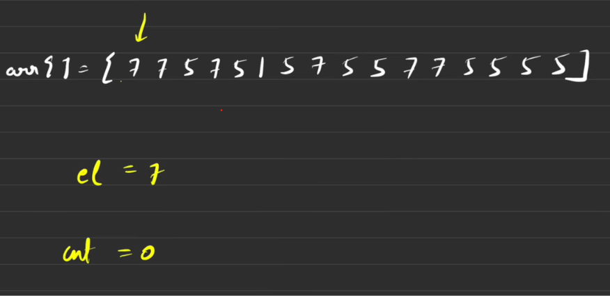
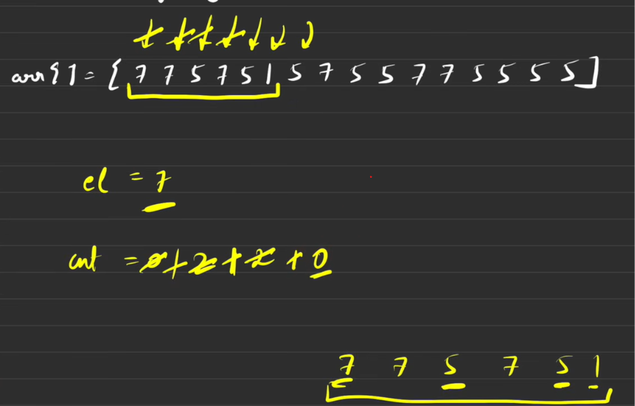
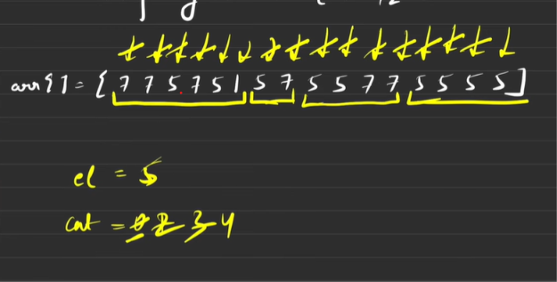

# Boyer-Moore Voting Algorithm

## Table of Contents

- [Overview](#overview)
- [Core Intuition](#core-intuition)
- [Complexity Analysis](#complexity-analysis)
- [Problems](#problems)

## Overview
- Moore's Voting Algorithm is an efficient algorithm used to find the majority element in an array.

- A majority element is an element that appears ```strictly more than N/2(floor) times```, where (N) is the size of the array.
- example- Input:  [2, 2, 1, 1, 1, 2, 2] -> Output: 2
  - The element 2 appears 4 times in an array of size 7.
  - Since (4 > 7/2), 2 is the majority element.

## Core Intuition
- The fundamental idea behind Moore's Voting Algorithm is **```cancellation```**.

  - Two different elements can be considered to cancel each other out.

  - The majority element appears more than all the other elements combined.

  - Therefore, even after cancelling different elements against it, at least one occurrence of the majority element must survive.

- As the theory won't be sufficient to understand , let's do it with an example
<br> <br>

- Initialize count as 0 , at every index i(used for looping through array) , if count is found to be 0 , we assume that element to be the majority element 
- Now in starting , as count=0 , our majority element(el) is arr[0] i.e. 7 -> do count++;
- Now loop through the array , ```if el is found -> count++ , if not found -> count--;```
<br> <br> <br>

- Now, as count becomes 0 , our majority element is 5 and do count++;
<br> <br>

- At the end , since 5 has some positive count -> it may be our majority element (el=5)
- After all this , run a loop and count occurence of el , if count of el > N/2 -> majority element found;

## Complexity Analysis

- If the problem ```explicitly states that array has a majority element``` , then we don't check the last loop as it is confirmed that our el found at last is the majority element <br>
Hence -  ```Time Complexity-> O(N) ,  Space Complexity-> O(1)``` 

<br> 

- If the problem does not guarantee us of majority element , we have to run the last loop as well to check the majority element(el) found at last is our actual majority element or not <br> 
Hence - ``` Time Complexity-> O(N)+O(N)=O(2N) , Space Complexity-> O(1)```


## Problems
- [Leetcode 169. Majority Element](https://leetcode.com/problems/majority-element/description/)
- [Leetcode 229. Majority Element II](https://leetcode.com/problems/majority-element-ii/description/) -> **important**