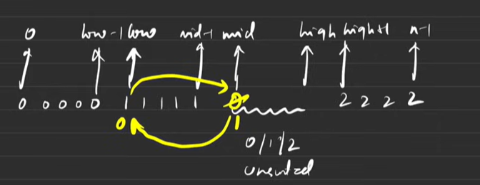
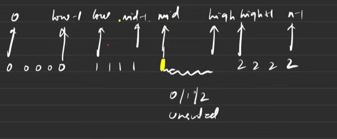
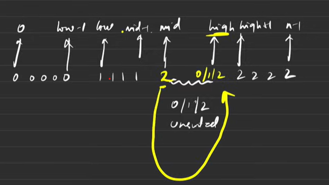

# Dutch National Flag Algorithm 

##  What is the Dutch National Flag Algorithm?
- The Dutch National Flag (DNF) algorithm is an in-place array partitioning technique used to divide an array into three groups in a single traversal.

- DNF exploits the fact that there are exactly three categories of values.

- It is commonly used when an array contains three distinct categories of elements, such as 0, 1, and 2.

- Suppose:-
```text
Input:  [2, 0, 2, 1, 1, 0]
Output: [0, 0, 1, 1, 2, 2]
```
The objective is to group all 0s first, followed by all 1s, and finally all 2s.

  - The algorithm maintains three pointers:

    - low: boundary of the region containing 0s.

    - mid: current element being examined.

    - high: boundary of the region containing 2s.


- Initialize these 3 pointers as
  ```text
  int low = 0;
  int mid = 0;
  int high = n - 1;
  ```

- [0.....low-1] -> 0 (extreme left)
- [low....mid-1] -> 1
- [high+1...N-1] -> 2 (extreme right)
- [mid.....high] -> unsorted part consisting of 0,1,2 -> which we need to sort using dutch national flag 
- Since , the portion from mid to high(both inclusive) is unsorted and array initially is unsorted , we take mid=0 and high=N-1 as this complete section is unsorted at start;
<br> <br> <br>



- In above case , swap 0(mid) with 1(low) - hence swap nums[low] and nums[mid]
<br> <br>

 
- In above case , as the array is already sorted till mid , we move mid by 1 place (mid++);
<br> <br>


- In above case , there maybe any element at high index , hence swap mid with high and do high-- , then leftmost part is sorted , now after swapping , nums[mid] maybe 0 , 1 or 2 , then we again apply these rules to sort the entire array.

## Code Template 
```cpp
while (mid <= high) {
    if (nums[mid] == 0) { // current element belongs to leftmost region
        swap(nums[low], nums[mid]);
        low++;
        mid++;
    }
    else if (nums[mid] == 1) { // The current element already belongs in the middle region.
        mid++;
    }
     else { // The current element belongs in the rightmost region.
        swap(nums[mid], nums[high]);
        high--;
    }
}
```

## Complexity Analysis
Time Complexity: O(n)  
Space Complexity: O(1)